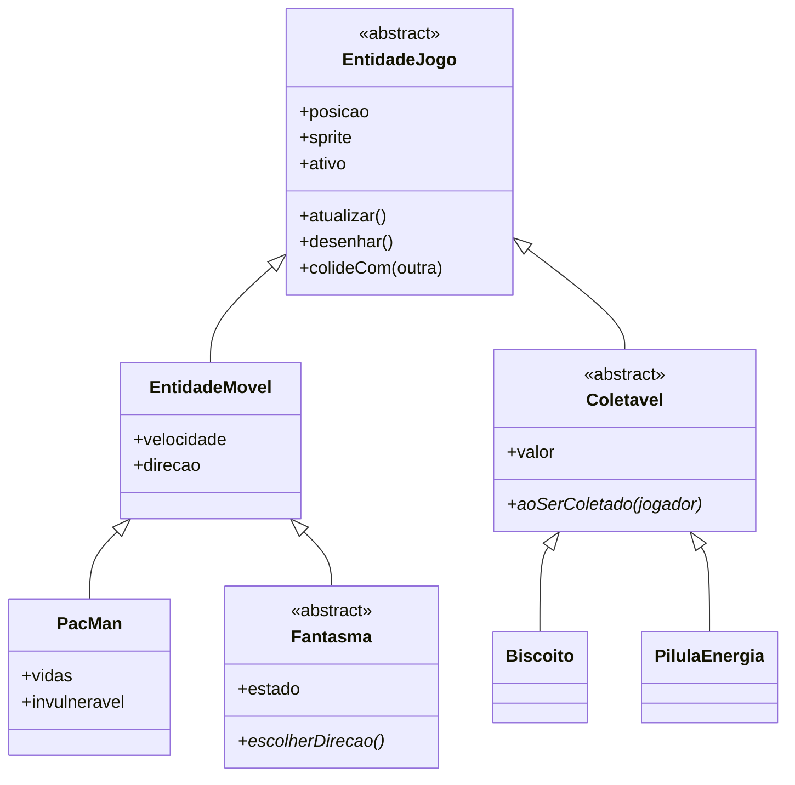

# 🟡 Pac-Man OOP: Releitura Orientada a Objetos do Clássico de Atari 2600

-blue)


---

<div align="center">
  <!-- Substitua pelo print do jogo em execução -->
  
  <br>
  <em>Prévia do jogo (substituir pela imagem final).</em>
</div>

---

## 📄 Visão Geral

Este repositório documenta o **Projeto Integrador (PI): Desenvolvimento de Sistemas Orientados a Objetos — Prática (ID: 218040P)**, da **PUC-Campinas**, sob orientação do professor **Leonardo Rezende Costa**.

O **Pac-Man OOP** é um clone do Pac-Man da versão de **Atari 2600** (1982, programada por Tod Frye), com um objetivo claro: o foco está na **estrutura do código**, e não só no resultado visual. A versão original precisou lidar com um cartucho de 4 KB e apenas 128 bytes de RAM, o que gerou soluções curiosas, como os fantasmas que cintilam porque só um é desenhado por quadro. Aqui partimos do mesmo jogo, mas sem essas amarras de hardware, e investimos o esforço na **modelagem de classes**.

> 🎯 **Métrica de sucesso do projeto:** adicionar um novo tipo de fantasma, um novo item ou uma nova fase deve exigir mexer no mínimo possível de código já pronto.

---

## 🎮 1. Sobre o Jogo

| Elemento | Definição |
| :--- | :--- |
| **Nome** | Pac-Man OOP |
| **Gênero** | Labirinto / Arcade 2D |
| **Modo de jogo** | Um jogador |
| **Visão** | De cima, com movimentação em grade |
| **Base** | Pac-Man (Atari 2600) |

### Como funciona

- O jogador controla o **Pac-Man**, que começa cada partida no centro do labirinto.
- O objetivo é **comer todos os biscoitos** espalhados pelos corredores. Quando o último some, a fase termina e o jogo avança.
- **Quatro fantasmas** patrulham o labirinto. O contato com qualquer um custa uma vida e o Pac-Man reaparece no ponto inicial. Sem vidas, fim de jogo.
- **Quatro pílulas de energia**, uma em cada canto, deixam o Pac-Man invulnerável por alguns segundos. Nesse período a dinâmica se inverte: os fantasmas fogem e podem ser comidos, rendendo pontos extras.
- **Itens especiais** aparecem de vez em quando no mapa e dão pontuação adicional.

> 🕹️ O efeito de cintilação dos fantasmas nasceu de uma limitação técnica do console e não é prioridade. Se sobrar tempo, pode entrar como opção de "modo retrô".

---

## 🧱 2. Arquitetura Orientada a Objetos

O sistema é dividido em dois grupos: os **elementos interativos**, que existem dentro do labirinto e reagem entre si, e os **gerenciadores**, que não aparecem na tela mas cuidam das regras e do fluxo da partida.

### 🔹 Elementos interativos (herança e polimorfismo)

Todos herdam da classe base abstrata `EntidadeJogo`, que guarda posição na grade, sprite, estado ativo/inativo e os métodos `atualizar()`, `desenhar()` e `colideCom(outra)`. O laço principal trata todas as entidades pela mesma interface, sem conhecer o tipo concreto de cada uma.

| Classe | Herda de | Responsabilidade |
| :--- | :--- | :--- |
| `EntidadeJogo` | (abstrata) | Base comum de tudo que existe no mapa |
| `EntidadeMovel` | `EntidadeJogo` | Velocidade, direção e checagem de paredes |
| `PacMan` | `EntidadeMovel` | Entrada do jogador, vidas e estado de invulnerabilidade |
| `Fantasma` | `EntidadeMovel` (abstrata) | Comportamento comum e estados (patrulha, assustado, comido) |
| `Fantasma` (4 subclasses) | `Fantasma` | Cada uma sobrescreve `escolherDirecao()` com sua estratégia de patrulha |
| `Coletavel` | `EntidadeJogo` (abstrata) | Valor em pontos e `aoSerColetado(jogador)` |
| `Biscoito` | `Coletavel` | Soma pontos e se desativa |
| `PilulaEnergia` | `Coletavel` | Soma pontos, ativa invulnerabilidade e avisa os fantasmas |

A troca de estado dos fantasmas será feita com o padrão **State**, evitando uma cadeia de `if` espalhada pelo código. Itens bônus ocasionais entram como uma nova subclasse de `Coletavel`, sem alterar as classes existentes.

### 🔹 Gerenciadores

| Gerenciador | Função |
| :--- | :--- |
| `GameManager` | Estado geral da partida (menu, jogando, pausado, fim de jogo), laço principal, fim de fase e derrota. Coordena os demais. |
| `ScoreManager` | Pontuação atual, recorde e vidas exibidas. Reage a eventos como "biscoito coletado" e "fantasma comido". |
| `MazeManager` | Carrega o mapa a partir de uma matriz (arquivo de texto), instancia paredes, biscoitos, pílulas e pontos de origem, responde consultas de colisão e controla a condição de vitória. |
| `SoundManager` | Centraliza efeitos sonoros e trilhas. As demais classes só o notificam, o que mantém o acoplamento baixo. |

Os gerenciadores se comunicam por **eventos simples** (por exemplo, o `PacMan` avisa que coletou algo e o `ScoreManager` e o `SoundManager` reagem), e não por referências diretas entre todos.

### 🗂️ Diagrama de classes (inicial)



> O mapeamento é inicial e deve mudar conforme a implementação avançar.

---

## 📁 3. Estrutura do Repositório

```text
.
├── README.md
├── docs/
│   ├── proposta.docx              # Proposta oficial do projeto
│   └── preview.png                # Print do jogo
├── src/                           # Código-fonte (entidades e gerenciadores)
├── assets/
│   ├── sprites/                   # Imagens do jogo
│   ├── sounds/                    # Efeitos sonoros e trilhas
│   └── levels/                    # Mapas das fases em arquivo de texto
└── LICENSE
```

> Ajuste a estrutura conforme os arquivos que o grupo adicionar.

---

## 🚀 4. Como Executar

_A ser preenchido quando a linguagem e as ferramentas de build forem definidas._

```bash
# clonar o repositório
git clone https://github.com/<usuario>/<repositorio>.git
cd <repositorio>

# instruções de compilação e execução serão adicionadas aqui
```

---

## 🗺️ Roadmap

- [x] Escrever a proposta do projeto
- [x] Mapear entidades e gerenciadores
- [ ] Definir linguagem, biblioteca gráfica e ferramentas de build
- [ ] Implementar `EntidadeJogo`, `EntidadeMovel` e `PacMan`
- [ ] Implementar `MazeManager` e carregamento de fases por arquivo de texto
- [ ] Implementar `Coletavel`, `Biscoito` e `PilulaEnergia`
- [ ] Implementar os quatro fantasmas com padrão State
- [ ] Implementar `ScoreManager` e `SoundManager`
- [ ] Integrar tudo no `GameManager` (menu, pausa, fim de jogo)
- [ ] Testes e ajustes finais
- [ ] _(Opcional)_ Modo retrô com cintilação dos fantasmas
- [ ] _(Opcional)_ Itens bônus ocasionais

---

## 👥 Integrantes do Grupo

| Nome | RA | E-mail | Contribuição |
| :--- | :---: | :--- | :--- |
| João Paulo Nunes Andrade | 25002703 | joao.pna@puccampinas.edu.br | |
| Gabriel de Oliveira Baptista | 25014604 | gabriel.ob1@puccampinas.edu.br | |
| Gustavo Antoniazzi Gouveia Santos | 25007671 | gustavo.ags@puccampinas.edu.br | |
| Enzo Marchi Romera | 25009691 | enzo.mr@puccampinas.edu.br | |

**Professor responsável:** Leonardo Rezende Costa ([leonardo.costa@puc-campinas.edu.br](mailto:leonardo.costa@puc-campinas.edu.br))

---

## 📚 Referências

1. Wikipédia. **Pac-Man (Atari 2600)**. Disponível em: <https://pt.wikipedia.org/wiki/Pac-Man_(Atari_2600)>.
2. Pac-Man Official Website. **History**. Disponível em: <https://pacman.com/en/history/>.
3. Pac-Man Fandom Wiki. **Pac-Man (Atari 2600)**. Disponível em: <https://pacman.fandom.com/wiki/Pac-Man_(Atari_2600)>.

---

## 📜 Licença

Este projeto está licenciado sob a Licença MIT. Veja o arquivo [LICENSE](LICENSE) para mais detalhes.

---

## 📬 Contato

<div align="center">
  <!-- Adicione os links do grupo -->
  <a href="mailto:joao.pna@puccampinas.edu.br"></a>
  <a href="https://github.com/seu-usuario" target="_blank"></a>
</div>
